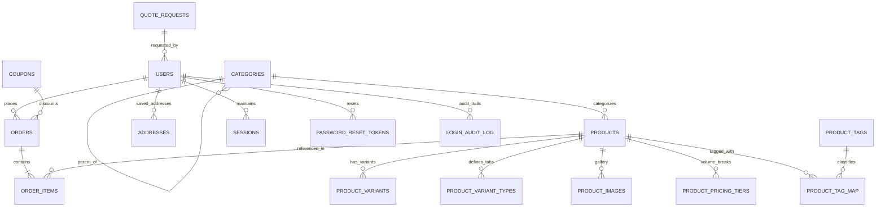

# CreativeKit 3A — Database Design & Architecture Specification

This document details the relational database design for the **CreativeKit 3A** corporate merchandising and e-commerce platform. It is engineered for **MySQL 8.0+ / MariaDB 10.5+** using the `InnoDB` storage engine with `utf8mb4` character encoding.

The corresponding executable SQL DDL and seed scripts are located in:
* [`database/schema.sql`](../database/schema.sql) — Core database schema and initial seed data.
* [`database/items-page.sql`](../database/items-page.sql) — Item variants and volume pricing additions.

---

## 1. Entity-Relationship Diagram (ERD)



---

## 2. Functional Domains & Data Architecture

The architecture is partitioned into five decoupled domains:

```
┌────────────────────────────────────────────────────────────────────────┐
│                        CREATIVEKIT 3A DATABASE                         │
├─────────────────────┬─────────────────────┬────────────────────────────┤
│ 1. Catalog & Items  │ 2. Quotes & Leads   │ 3. Users & Auth            │
│  - categories       │  - quote_requests   │  - users                   │
│  - products         │  - contact_messages │  - addresses               │
│  - product_variants │  - email_subscriber │  - sessions                │
│  - variant_types    │                     │  - password_reset_tokens   │
│  - pricing_tiers    │                     │  - login_audit_log         │
│  - images & tags    │                     │                            │
├─────────────────────┼─────────────────────┴────────────────────────────┤
│ 4. Orders & Checkout│ 5. CMS & Site Configuration                      │
│  - orders           │  - hero_banners                                  │
│  - order_items      │  - clients                                       │
│  - coupons          │  - site_settings                                 │
└─────────────────────┴──────────────────────────────────────────────────┘
```

---

## 3. Data Dictionary & Table Schemas

### Domain 1: Product Catalog & Item Variants

#### `categories`
Hierarchical tree of main product categories and subcategories (self-referencing via `parent_id`).

| Column | Type | Nullable | Key | Default | Description |
|---|---|---|---|---|---|
| `id` | INT UNSIGNED | No | PK | Auto | Unique category identifier |
| `parent_id` | INT UNSIGNED | Yes | FK | NULL | Parent category (`NULL` for main categories) |
| `name` | VARCHAR(150) | No | | | Category title (e.g., `Drinkware`) |
| `slug` | VARCHAR(160) | No | UQ | | URL identifier (e.g., `drinkware`) |
| `description` | TEXT | Yes | | NULL | SEO and catalog description |
| `image_url` | VARCHAR(512) | Yes | | NULL | Category banner/thumbnail path |
| `sort_order` | SMALLINT | No | | 0 | Display priority (ascending) |
| `is_active` | TINYINT(1) | No | IDX | 1 | Visibility toggle (1 = visible, 0 = hidden) |
| `created_at` | DATETIME | No | | CURRENT_TIMESTAMP | Record creation timestamp |
| `updated_at` | DATETIME | No | | CURRENT_TIMESTAMP | Auto-updated on modification |

#### `products`
Parent product definitions displayed on catalog and category pages.

| Column | Type | Nullable | Key | Default | Description |
|---|---|---|---|---|---|
| `id` | INT UNSIGNED | No | PK | Auto | Unique product identifier |
| `category_id` | INT UNSIGNED | Yes | FK | NULL | Subcategory foreign key reference |
| `name` | VARCHAR(255) | No | | | Product name (e.g., `Bamboo Tumblers`) |
| `slug` | VARCHAR(270) | No | UQ | | Unique SEO URL slug |
| `sku` | VARCHAR(100) | Yes | UQ | NULL | Stock Keeping Unit |
| `short_desc` | VARCHAR(500) | Yes | | NULL | Card summary snippet |
| `description` | LONGTEXT | Yes | | NULL | Full product specifications & details |
| `thumbnail_url` | VARCHAR(512) | Yes | | NULL | Primary catalog display image |
| `base_price` | DECIMAL(10,2) | No | IDX | 0.00 | Starting display price |
| `sale_price` | DECIMAL(10,2) | Yes | | NULL | Discounted promotional price |
| `stock_qty` | INT | No | | 0 | On-hand raw inventory |
| `is_customizable` | TINYINT(1) | No | | 1 | Supports custom branding/engraving |
| `is_featured` | TINYINT(1) | No | IDX | 0 | Displayed in homepage featured section |
| `is_active` | TINYINT(1) | No | IDX | 1 | Live status |
| `sort_order` | SMALLINT | No | | 0 | Sorting sequence |

#### `product_variants`
Specific models, finishes, capacities, and editions within a parent product.

| Column | Type | Nullable | Key | Default | Description |
|---|---|---|---|---|---|
| `id` | INT UNSIGNED | No | PK | Auto | Unique variant identifier |
| `product_id` | INT UNSIGNED | No | FK | | Parent product ID (cascade delete) |
| `variant_type` | VARCHAR(100) | Yes | IDX | NULL | Filter tab key (e.g., `single`, `dual`) |
| `name` | VARCHAR(255) | No | | | Variant title (e.g., `450ml Matte Black`) |
| `slug` | VARCHAR(270) | No | UQ | | Deep-linking URL slug |
| `specs` | VARCHAR(500) | Yes | | NULL | Short bullet summary (e.g., `304 Steel • Vacuum`) |
| `thumbnail_url` | VARCHAR(512) | Yes | | NULL | Variant image path |
| `base_price` | DECIMAL(10,2) | No | | 0.00 | Variant starting price |
| `sale_price` | DECIMAL(10,2) | Yes | | NULL | Variant promotional price |
| `badge_label` | VARCHAR(80) | Yes | | NULL | Marketing badge (`Best Seller`, `New`, `Eco`) |
| `is_active` | TINYINT(1) | No | IDX | 1 | Variant status |
| `sort_order` | SMALLINT | No | IDX | 0 | Sorting sequence within tab |

#### `product_variant_types`
Dynamic filter tab labels displayed on item variant pages.

| Column | Type | Nullable | Key | Default | Description |
|---|---|---|---|---|---|
| `id` | INT UNSIGNED | No | PK | Auto | Unique tab identifier |
| `product_id` | INT UNSIGNED | No | FK | | Parent product ID |
| `type_key` | VARCHAR(100) | No | UQ | | Internal filter key (`single`, `dual`) |
| `type_label` | VARCHAR(150) | No | | | Display label (`Single Port`, `Dual Port`) |
| `sort_order` | SMALLINT | No | | 0 | Tab display order |

#### `product_pricing_tiers`
Volume break price matrix for wholesale corporate quoting.

| Column | Type | Nullable | Key | Default | Description |
|---|---|---|---|---|---|
| `id` | INT UNSIGNED | No | PK | Auto | Tier identifier |
| `product_id` | INT UNSIGNED | No | FK | | Associated product |
| `size_label` | VARCHAR(50) | Yes | | NULL | Optional size or capacity constraint |
| `min_qty` | INT UNSIGNED | No | IDX | | Minimum pieces for tier |
| `max_qty` | INT UNSIGNED | Yes | | NULL | Upper piece limit (`NULL` = and above) |
| `unit_price` | DECIMAL(10,2) | No | | | Discounted unit price for tier |

---

### Domain 2: Quotations & Customer Inquiries

#### `quote_requests`
Stores multi-step quotation submissions gathered from `assets/js/quote-modal.js`.

| Column | Type | Nullable | Key | Default | Description |
|---|---|---|---|---|---|
| `id` | INT UNSIGNED | No | PK | Auto | Request record ID |
| `quote_ref` | VARCHAR(40) | No | UQ | | Unique reference code (e.g., `CK3A-849201`) |
| `full_name` | VARCHAR(200) | No | | | Customer full name |
| `company_name` | VARCHAR(200) | Yes | | NULL | Corporate entity name |
| `email` | VARCHAR(255) | No | IDX | | Contact email address |
| `phone` | VARCHAR(50) | No | | | Contact phone / mobile number |
| `product_type` | VARCHAR(100) | No | IDX | | Selected product category or name |
| `quantity_range`| VARCHAR(50) | No | | | Target quantity range (e.g., `100-299 pcs`) |
| `target_budget` | VARCHAR(50) | Yes | | NULL | Customer budget range |
| `target_deadline`| DATE | Yes | | NULL | Event or delivery required date |
| `project_details`| TEXT | Yes | | NULL | Custom notes, logo placement specs |
| `customization_options` | JSON | Yes | | NULL | Array of required processes (`["embroidery", "laser"]`) |
| `source_url` | VARCHAR(512) | Yes | | NULL | Origin page where quote was submitted |
| `status` | ENUM | No | IDX | `'new'` | `'new'`, `'contacted'`, `'quoted'`, `'in_production'`, `'completed'`, `'cancelled'` |
| `created_at` | DATETIME | No | IDX | CURRENT_TIMESTAMP | Submission timestamp |

#### `contact_messages`
Standard inquiry messages from the Contact Us form.

| Column | Type | Nullable | Key | Default | Description |
|---|---|---|---|---|---|
| `id` | INT UNSIGNED | No | PK | Auto | Message ID |
| `full_name` | VARCHAR(200) | No | | | Sender name |
| `email` | VARCHAR(255) | No | | | Sender email |
| `phone` | VARCHAR(30) | Yes | | NULL | Sender phone |
| `subject` | VARCHAR(255) | Yes | | NULL | Message subject |
| `message` | TEXT | No | | | Message text |
| `is_read` | TINYINT(1) | No | IDX | 0 | Read flag |
| `replied_at` | DATETIME | Yes | | NULL | Reply timestamp |

---

### Domain 3: User Accounts & Security Audit

#### `users`
Customer and staff credentials with bcrypt password hashing.

| Column | Type | Nullable | Key | Default | Description |
|---|---|---|---|---|---|
| `id` | INT UNSIGNED | No | PK | Auto | User identifier |
| `first_name` | VARCHAR(100) | No | | | First name |
| `last_name` | VARCHAR(100) | No | | | Last name |
| `email` | VARCHAR(255) | No | UQ | | Verified corporate/personal email |
| `phone` | VARCHAR(30) | Yes | | NULL | Mobile contact |
| `password_hash`| VARCHAR(255) | No | | | 60-character bcrypt hash |
| `role` | ENUM | No | IDX | `'customer'` | `'customer'`, `'admin'`, `'staff'` |
| `is_verified` | TINYINT(1) | No | | 0 | Email verified status |
| `is_active` | TINYINT(1) | No | IDX | 1 | Account active toggle |
| `last_login_at`| DATETIME | Yes | | NULL | Timestamp of latest login |

#### `login_audit_log`
Security audit trail recording every authentication attempt.

| Column | Type | Nullable | Key | Default | Description |
|---|---|---|---|---|---|
| `id` | INT UNSIGNED | No | PK | Auto | Log record ID |
| `user_id` | INT UNSIGNED | Yes | FK | NULL | User ID if email matched |
| `email_tried` | VARCHAR(255) | No | IDX | | Email entered at form |
| `ip_address` | VARCHAR(45) | Yes | IDX | NULL | Client IP address (IPv4/IPv6) |
| `user_agent` | VARCHAR(512) | Yes | | NULL | Browser User-Agent string |
| `success` | TINYINT(1) | No | IDX | 0 | 1 = success, 0 = failed |
| `fail_reason` | VARCHAR(100) | Yes | | NULL | `wrong_password`, `not_found`, `inactive` |
| `created_at` | DATETIME | No | IDX | CURRENT_TIMESTAMP | Attempt timestamp |

---

### Domain 4: Orders & Transactions

#### `orders`
E-commerce orders and finalized quotation contracts.

| Column | Type | Nullable | Key | Default | Description |
|---|---|---|---|---|---|
| `id` | INT UNSIGNED | No | PK | Auto | Order ID |
| `user_id` | INT UNSIGNED | Yes | FK | NULL | Registered user (`NULL` for guest) |
| `order_number` | VARCHAR(40) | No | UQ | | Human-friendly reference (e.g. `CK-2026-0012`) |
| `status` | ENUM | No | IDX | `'pending'` | `'pending'`, `'confirmed'`, `'in_production'`, `'shipped'`, `'delivered'`, `'cancelled'` |
| `subtotal` | DECIMAL(12,2) | No | | 0.00 | Net items total |
| `discount_amount`| DECIMAL(12,2)| No | | 0.00 | Applied coupon discount |
| `total_amount` | DECIMAL(12,2) | No | | 0.00 | Final payable amount |
| `payment_status`| ENUM | No | | `'unpaid'`| `'unpaid'`, `'paid'`, `'refunded'` |
| `ship_full_name`| VARCHAR(200) | Yes | | NULL | Address snapshot at checkout |
| `ship_city` | VARCHAR(100) | Yes | | NULL | Delivery city |
| `ship_province` | VARCHAR(100) | Yes | | NULL | Delivery province |

#### `order_items`
Individual line items in an order, storing customization options as immutable snapshots.

| Column | Type | Nullable | Key | Default | Description |
|---|---|---|---|---|---|
| `id` | INT UNSIGNED | No | PK | Auto | Order item ID |
| `order_id` | INT UNSIGNED | No | FK | | Parent order ID (cascade delete) |
| `product_id` | INT UNSIGNED | Yes | FK | NULL | Original product reference |
| `product_name` | VARCHAR(255) | No | | | Product name snapshot at checkout |
| `quantity` | INT UNSIGNED | No | | 1 | Ordered count |
| `unit_price` | DECIMAL(10,2) | No | | | Price per unit |
| `line_total` | DECIMAL(12,2) | No | | | Total line amount (`qty * price`) |
| `custom_text` | VARCHAR(255) | Yes | | NULL | Embroidered/printed text |
| `artwork_url` | VARCHAR(512) | Yes | | NULL | Uploaded vector logo file path |

---

### Domain 5: CMS & Marketing

* `hero_banners`: Manages the homepage carousel slides (`title`, `subtitle`, `eyebrow`, `image_url`, `cta_url`, `bg_class`).
* `coupons`: Promotional codes supporting percentage and fixed discounts (`code`, `discount_type`, `discount_value`, `min_order_total`, `max_uses`).
* `site_settings`: Dynamic key-value pairs for site name, contact numbers, email, and tax rates.

---

## 4. Database Normalization Analysis

* **First Normal Form (1NF):**
  * All attributes are atomic. Multi-value attributes like tags, variant tabs, and multiple images are split into dedicated relational tables (`product_tag_map`, `product_variant_types`, `product_images`).
* **Second Normal Form (2NF):**
  * All non-key attributes are fully functionally dependent on the primary key. Composite primary keys in intersection tables (`product_tag_map(product_id, tag_id)`) contain only foreign keys.
* **Third Normal Form (3NF):**
  * Transitive dependencies have been eliminated. Order snapshots (`order_items.product_name`, `orders.ship_city`) intentionally preserve historical integrity without relying on changing master records.

---

## 5. Stored Procedures & Business Logic

| Stored Procedure | Parameters | Purpose |
|---|---|---|
| `submit_quote_request` | `IN full_name, email, phone, product_type, qty, budget, details... OUT quote_ref, request_id` | Generates a formatted quote reference (`CK3A-XXXXXX`), inserts into `quote_requests`, and returns the reference code. |
| `register_user` | `IN first_name, last_name, email, phone, password_hash, OUT result, new_user_id` | Verifies email uniqueness and safely creates a customer account. |
| `login_user` | `IN email, ip, user_agent, OUT user_id, password_hash, role, result` | Validates active status and returns the hash for bcrypt comparison while creating an audit entry. |
| `record_login_success` | `IN user_id, email, ip, user_agent` | Updates `last_login_at` timestamp and logs successful sign-in. |
| `cleanup_expired_tokens`| *None* | Scheduled maintenance procedure removing expired reset tokens and stale sessions. |
