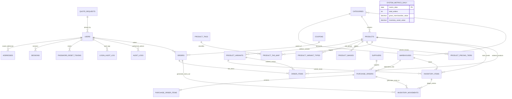

# CreativeKit 3A — Enterprise Database Design & Architecture Specification

This specification documents the complete enterprise relational database architecture for **CreativeKit 3A** corporate merchandising, incorporating the newly integrated **Purchasing System**, **Inventory Management System**, and **Management Information System (MIS)** alongside the core e-commerce catalog, customer authentication, quotation, and ordering engines.

Engineered for **MySQL 8.0+ / MariaDB 10.5+** using the `InnoDB` ACID transaction engine with `utf8mb4_unicode_ci` collations.

* **DDL & Seed Source:** [`database/schema.sql`](../database/schema.sql)
* **Items & Tiers Extension:** [`database/items-page.sql`](../database/items-page.sql)

---

## 1. Enterprise Entity-Relationship Diagram (ERD)



---

## 2. Functional Domains & Subsystem Architecture

The enterprise database is decomposed into eight decoupled, interconnected operational domains:

```
┌────────────────────────────────────────────────────────────────────────────────────────┐
│                        CREATIVEKIT 3A ENTERPRISE ARCHITECTURE                          │
├─────────────────────────┬──────────────────────────┬───────────────────────────────────┤
│ 1. Core Catalog         │ 2. Customer & Identity   │ 3. Quotation & Leads              │
│  - categories           │  - users                 │  - quote_requests                 │
│  - products             │  - addresses             │  - contact_messages               │
│  - product_variants     │  - sessions              │  - email_subscribers              │
│  - product_variant_types│  - password_reset_tokens │                                   │
│  - product_images       │  - login_audit_log       │                                   │
│  - pricing_tiers / tags │                          │                                   │
├─────────────────────────┼──────────────────────────┼───────────────────────────────────┤
│ 4. Purchasing System    │ 5. Inventory System      │ 6. Information System (MIS)       │
│  - suppliers            │  - warehouses            │  - system_metrics_daily           │
│  - purchase_orders      │  - inventory_items       │  - audit_logs                     │
│  - purchase_order_items │  - inventory_movements   │  - v_mis_executive_kpi (View)     │
├─────────────────────────┼──────────────────────────┼───────────────────────────────────┤
│ 7. Orders & Checkout    │ 8. CMS & Site Engine                                         │
│  - orders               │  - hero_banners                                              │
│  - order_items          │  - clients                                                   │
│  - coupons              │  - site_settings                                             │
└─────────────────────────┴──────────────────────────────────────────────────────────────┘
```

---

## 3. Detailed Data Dictionary

### Domain 1: Core Catalog Subsystem

#### `categories`
Hierarchical tree of categories and subcategories (self-referencing via `parent_id`).

| Column | Type | Nullable | Key | Default | Description |
|---|---|---|---|---|---|
| `id` | INT UNSIGNED | No | PK | Auto | Category unique identifier |
| `parent_id` | INT UNSIGNED | Yes | FK | NULL | Parent category (`NULL` for root categories) |
| `name` | VARCHAR(150) | No | | | Category name (e.g., `Drinkware`, `Apparel`) |
| `slug` | VARCHAR(160) | No | UQ | | Canonical SEO slug |
| `description` | TEXT | Yes | | NULL | Public merchandising overview |
| `image_url` | VARCHAR(512) | Yes | | NULL | Banner or card visual image asset |
| `sort_order` | SMALLINT | No | | 0 | Display sequence order |
| `is_active` | TINYINT(1) | No | IDX | 1 | Visibility flag (1 = active, 0 = hidden) |
| `created_at` | DATETIME | No | | CURRENT_TIMESTAMP | Row insertion timestamp |
| `updated_at` | DATETIME | No | | CURRENT_TIMESTAMP | Record modification timestamp |

#### `products`
Master catalog items displayed on storefront catalog and category listings.

| Column | Type | Nullable | Key | Default | Description |
|---|---|---|---|---|---|
| `id` | INT UNSIGNED | No | PK | Auto | Product unique identifier |
| `category_id` | INT UNSIGNED | Yes | FK | NULL | Assigned category foreign key |
| `name` | VARCHAR(255) | No | | | Product name (e.g., `Bamboo Tumblers`) |
| `slug` | VARCHAR(270) | No | UQ | | Canonical URL slug |
| `sku` | VARCHAR(100) | Yes | UQ | NULL | Master Stock Keeping Unit |
| `short_desc` | VARCHAR(500) | Yes | | NULL | Concise listing card summary |
| `description` | LONGTEXT | Yes | | NULL | Comprehensive product specifications |
| `thumbnail_url`| VARCHAR(512) | Yes | | NULL | Primary listing thumbnail asset |
| `base_price` | DECIMAL(10,2) | No | IDX | 0.00 | Catalog display reference price |
| `sale_price` | DECIMAL(10,2) | Yes | | NULL | Promotional discounted price |
| `stock_qty` | INT | No | | 0 | Cached aggregate inventory count |
| `min_order_qty`| INT | No | | 1 | Minimum order threshold |
| `is_active` | TINYINT(1) | No | IDX | 1 | Storefront availability |
| `is_featured`| TINYINT(1) | No | IDX | 0 | Featured showcase flag |
| `created_at` | DATETIME | No | | CURRENT_TIMESTAMP | Creation timestamp |
| `updated_at` | DATETIME | No | | CURRENT_TIMESTAMP | Last modified |

---

### Domain 4: Purchasing System (Procurement & Vendor Management)

#### `suppliers`
Maintains verified vendor directory, manufacturers, contact representatives, and contract terms.

| Column | Type | Nullable | Key | Default | Description |
|---|---|---|---|---|---|
| `id` | INT UNSIGNED | No | PK | Auto | Primary key |
| `supplier_code` | VARCHAR(50) | No | UQ | | Unique code (e.g. `SUP-001`) |
| `company_name` | VARCHAR(255) | No | | | Registered business legal name |
| `contact_person`| VARCHAR(150) | Yes | | NULL | Key account representative name |
| `email` | VARCHAR(191) | Yes | | NULL | Procurement correspondence email |
| `phone` | VARCHAR(50) | Yes | | NULL | Telephone or mobile contact |
| `address` | TEXT | Yes | | NULL | Facility or headquarters address |
| `tax_identification_number` | VARCHAR(50) | Yes | | NULL | Official BIR/TIN tax registration |
| `payment_terms`| VARCHAR(100) | Yes | | 'Net 30' | Agreed terms (Net 30, COD, 50% Adv) |
| `rating` | DECIMAL(3,2) | No | | 5.00 | Performance rating (1.00 to 5.00) |
| `is_active` | TINYINT(1) | No | IDX | 1 | Vendor status (1 = active, 0 = suspended) |
| `created_at` | DATETIME | No | | CURRENT_TIMESTAMP | Creation timestamp |
| `updated_at` | DATETIME | No | | CURRENT_TIMESTAMP | Last modified |

#### `purchase_orders`
Tracks procurement transactions issued to suppliers for replenishing stock.

| Column | Type | Nullable | Key | Default | Description |
|---|---|---|---|---|---|
| `id` | INT UNSIGNED | No | PK | Auto | Primary key |
| `po_number` | VARCHAR(50) | No | UQ | | Unique PO number (e.g. `PO-2026-001`) |
| `supplier_id` | INT UNSIGNED | No | FK | | Referencing `suppliers.id` |
| `warehouse_id` | INT UNSIGNED | No | FK | | Destination hub (`warehouses.id`) |
| `order_date` | DATE | No | IDX | CURRENT_DATE | Date PO was officially generated |
| `expected_date`| DATE | Yes | | NULL | Expected delivery date |
| `received_date`| DATE | Yes | | NULL | Actual date goods receipt occurred |
| `status` | ENUM | No | IDX | 'draft' | `draft`, `sent`, `partially_received`, `received`, `cancelled` |
| `subtotal` | DECIMAL(12,2) | No | | 0.00 | Net PO valuation |
| `tax_amount` | DECIMAL(10,2) | No | | 0.00 | Value Added Tax (VAT 12%) |
| `shipping_cost`| DECIMAL(10,2) | No | | 0.00 | Freight/logistics charge |
| `total_amount` | DECIMAL(12,2) | No | | 0.00 | Gross PO liability |
| `payment_status`| ENUM | No | | 'unpaid' | `unpaid`, `partially_paid`, `paid` |
| `notes` | TEXT | Yes | | NULL | Instructions or shipping remarks |
| `created_by` | INT UNSIGNED | Yes | FK | NULL | Operator or user who created the PO |

#### `purchase_order_items`
Individual product lines, order quantities, costs, and received progress for a PO.

| Column | Type | Nullable | Key | Default | Description |
|---|---|---|---|---|---|
| `id` | INT UNSIGNED | No | PK | Auto | Primary key |
| `purchase_order_id`| INT UNSIGNED | No | FK | | References `purchase_orders.id` |
| `product_id` | INT UNSIGNED | Yes | FK | NULL | References catalog `products.id` |
| `product_variant_id`| INT UNSIGNED | Yes | FK | NULL | References `product_variants.id` |
| `item_name` | VARCHAR(255) | No | | | Product name snapshot at order |
| `sku` | VARCHAR(100) | Yes | | NULL | Stock Keeping Unit |
| `quantity_ordered`| INT UNSIGNED | No | | | Number of units procured |
| `quantity_received`| INT UNSIGNED| No | | 0 | Number of units verified on receipt |
| `unit_cost` | DECIMAL(10,2) | No | | | Negotiated procurement cost per unit |
| `line_total` | DECIMAL(12,2) | No | | | Computed `quantity_ordered * unit_cost` |

---

### Domain 5: Multi-Warehouse Inventory System

#### `warehouses`
Physical fulfillment and storage hubs across the Philippines.

| Column | Type | Nullable | Key | Default | Description |
|---|---|---|---|---|---|
| `id` | INT UNSIGNED | No | PK | Auto | Primary key |
| `warehouse_code`| VARCHAR(20) | No | UQ | | Internal code (`WH-QC`, `WH-MM`, `WH-CEB`) |
| `name` | VARCHAR(100) | No | | | Facility name |
| `location` | VARCHAR(255) | No | | | Physical city/district address |
| `contact_number`| VARCHAR(50) | Yes | | NULL | Warehouse logistics contact |
| `is_active` | TINYINT(1) | No | | 1 | Hub operational status |

#### `inventory_items`
Real-time physical stock matrix mapping products/variants to specific warehouses.

| Column | Type | Nullable | Key | Default | Description |
|---|---|---|---|---|---|
| `id` | INT UNSIGNED | No | PK | Auto | Primary key |
| `warehouse_id` | INT UNSIGNED | No | FK | | Assigned storage warehouse |
| `product_id` | INT UNSIGNED | No | FK | | References `products.id` |
| `product_variant_id`| INT UNSIGNED| Yes | FK | NULL | References variant (if applicable) |
| `quantity_on_hand`| INT | No | IDX | 0 | Total physical units stored |
| `quantity_reserved`| INT | No | | 0 | Units locked in processing orders |
| `quantity_available`| INT GENERATED | No | | (QOH - QR) | Computed available for sale |
| `reorder_threshold`| INT | No | | 50 | Minimum safety stock before alert |
| `reorder_quantity` | INT | No | | 200 | Recommended restock batch size |
| `bin_location` | VARCHAR(50) | Yes | | NULL | Aisle/shelf code (e.g. `Aisle 3-B2`) |

#### `inventory_movements`
Append-only immutable stock transaction ledger tracking every stock-in, stock-out, transfer, and adjustment.

| Column | Type | Nullable | Key | Default | Description |
|---|---|---|---|---|---|
| `id` | INT UNSIGNED | No | PK | Auto | Primary key |
| `movement_number`| VARCHAR(60) | No | UQ | | Unique transaction code (`MOV-...`) |
| `inventory_item_id`| INT UNSIGNED| No | FK | | Target inventory record |
| `movement_type` | ENUM | No | IDX | | `stock_in`, `stock_out`, `transfer`, `adjustment`, `damaged`, `returned` |
| `quantity_change`| INT | No | | | Signed integer (+50 or -10) |
| `reference_type`| VARCHAR(40) | Yes | | NULL | Source (`purchase_order`, `order`, `manual`) |
| `reference_id` | INT UNSIGNED | Yes | | NULL | Source primary key |
| `notes` | VARCHAR(500) | Yes | | NULL | Audit justification or batch remarks |
| `performed_by` | VARCHAR(100) | Yes | | 'system' | Responsible operator |
| `created_at` | DATETIME | No | IDX | CURRENT_TIMESTAMP | Transaction timestamp |

---

### Domain 6: Management Information System (MIS) & Governance

#### `system_metrics_daily`
Executive business intelligence rollups aggregated every 24 hours.

| Column | Type | Nullable | Key | Default | Description |
|---|---|---|---|---|---|
| `metric_date` | DATE | No | PK | | Calendar reporting date |
| `total_orders` | INT UNSIGNED | No | | 0 | Daily volume of placed orders |
| `gross_merchandise_value`| DECIMAL(14,2)| No | | 0.00 | Total customer invoice volume (₱) |
| `total_quotes_received` | INT UNSIGNED | No | | 0 | New enterprise B2B quote inquiries |
| `total_procurement_spend`| DECIMAL(14,2)| No | | 0.00 | Outflows for received POs (₱) |
| `inventory_asset_value` | DECIMAL(14,2)| No | | 0.00 | Snapshot valuation of stock assets |
| `low_stock_sku_count` | INT UNSIGNED | No | | 0 | SKUs below threshold |

#### `audit_logs`
Enterprise security, compliance, and user action tracking.

| Column | Type | Nullable | Key | Default | Description |
|---|---|---|---|---|---|
| `id` | BIGINT UNSIGNED | No | PK | Auto | Primary key |
| `user_id` | INT UNSIGNED | Yes | FK | NULL | Acting user ID (NULL if automated) |
| `action` | VARCHAR(100) | No | IDX | | Verb (`PO_CREATED`, `STOCK_ADJUSTED`, etc.) |
| `module` | VARCHAR(60) | No | IDX | | Subsystem (`inventory`, `purchasing`, `auth`) |
| `record_id` | VARCHAR(60) | Yes | | NULL | Primary key of affected record |
| `details` | JSON | Yes | | NULL | Full metadata, diffs, or snapshot |
| `ip_address` | VARCHAR(45) | Yes | | NULL | Client IP (IPv4 or IPv6) |
| `user_agent` | VARCHAR(255) | Yes | | NULL | Client browser string |
| `created_at` | DATETIME | No | IDX | CURRENT_TIMESTAMP | Execution timestamp |

---

## 4. Stored Procedures & Business Logic

### 1. `record_stock_movement`
Atomically records a stock ledger transaction in `inventory_movements` and adjusts `inventory_items.quantity_on_hand` within an isolated ACID transaction.
```sql
CALL record_stock_movement(
  'manual',          -- p_ref_type
  0,                 -- p_ref_id
  1,                 -- p_inventory_item_id
  'stock_in',        -- p_movement_type
  50,                -- p_qty_change
  'Periodic restock',-- p_notes
  'Warehouse Mgr'    -- p_operator
);
```

### 2. `receive_purchase_order`
Processes goods receipt for an outstanding Purchase Order:
1. Validates PO status is `sent` or `draft`.
2. Marks PO as `received` with `received_date = CURRENT_DATE`.
3. Iterates over line items in `purchase_order_items`, updates `quantity_received`.
4. Automatically increments `inventory_items.quantity_on_hand` at the destination warehouse.
5. Emits an immutable `stock_in` transaction in `inventory_movements`.
6. Logs the operation into `audit_logs`.

```sql
CALL receive_purchase_order('PO-2026-001');
```

---

## 5. Analytics Views

* **`v_inventory_summary`**: Combines product SKU, title, category, warehouse location, on-hand units, reserved units, available units, unit valuation, and computed status (`In Stock`, `Low Stock`, `Out of Stock`).
* **`v_purchasing_summary`**: Aggregates purchase orders, supplier information, delivery dates, payment statuses, total procurement amounts, and unit progress.
* **`v_mis_executive_kpi`**: Single-row KPI aggregate delivering real-time executive counts: total active products, warehouse stock valuation, low stock alert counter, procurement spend, pending quotes, and active customer base.
