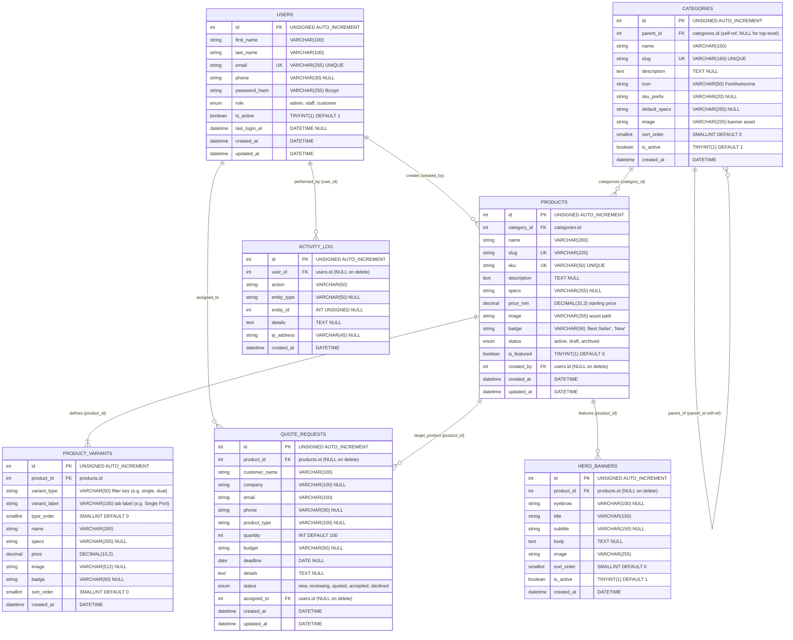
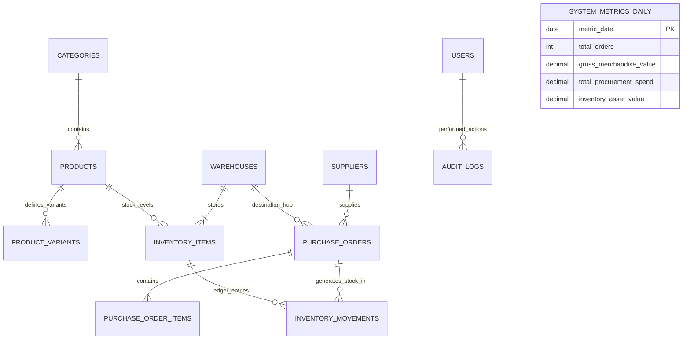

# CreativeKit 3A — Comprehensive Database Design & Architecture Specification

> **Database System:** MySQL 8.0+ / MariaDB 10.5+  
> **Storage Engine:** `InnoDB` (ACID Compliant)  
> **Character Set / Collation:** `utf8mb4` / `utf8mb4_unicode_ci`  
> **Active Implementation Script:** [`database/creativekit3a.sql`](../database/creativekit3a.sql)  
> **Database Name:** `creativekit3a_db`

---

## Table of Contents
1. [Active Production Database ERD (Live System)](#1-active-production-database-erd-live-system)
2. [Relationship & Cardinality Matrix](#2-relationship--cardinality-matrix)
3. [Active System DDL Queries (CREATE TABLE)](#3-active-system-ddl-queries-create-table)
4. [Data Dictionary & Table Specifications](#4-data-dictionary--table-specifications)
5. [Production SQL Query Patterns (JOINs, Aggregates, CRUD)](#5-production-sql-query-patterns-joins-aggregates-crud)
6. [Enterprise Extended Architecture (Purchasing, Inventory, MIS)](#6-enterprise-extended-architecture-purchasing-inventory-mis)
7. [Enterprise Stored Procedures & Analytic Views](#7-enterprise-stored-procedures--analytic-views)

---

## 1. Active Production Database ERD (Live System)

This diagram represents the **7 interrelated production tables** actively queried and updated by the PHP backend (`config/db.php`, `category-page.php`, `product/car-charger-adapters.php`, `admin/`, etc.).



---

## 2. Relationship & Cardinality Matrix

| Parent Table | Child Table | Foreign Key Column | Cardinality | Referential Action (ON DELETE / ON UPDATE) | Business Rule Description |
| :--- | :--- | :--- | :---: | :---: | :--- |
| `categories` | `categories` | `parent_id` | **1 : N** | `SET NULL` / `CASCADE` | **Self-referencing hierarchy.** Top categories have `parent_id = NULL` (e.g. *Drinkware*). Subcategories store their parent category ID (e.g. *Tumblers & Flasks*). |
| `categories` | `products` | `category_id` | **1 : N** | `CASCADE` / `CASCADE` | A product must belong to a subcategory. Removing a category removes its associated products. |
| `products` | `product_variants`| `product_id` | **1 : N** | `CASCADE` / `CASCADE` | One catalog product encompasses multiple variant options (color, port type, capacity). |
| `products` | `quote_requests` | `product_id` | **1 : N** | `SET NULL` / `CASCADE` | B2B clients request quotations for a specific catalog item. If product is deleted, quote request is preserved. |
| `products` | `hero_banners` | `product_id` | **1 : N** | `SET NULL` / `CASCADE` | Carousel banner slides link to promoted catalog products. |
| `users` | `products` | `created_by` | **1 : N** | `SET NULL` / `CASCADE` | Tracks the administrator or procurement officer who created the product record. |
| `users` | `quote_requests` | `assigned_to` | **1 : N** | `SET NULL` / `CASCADE` | Leads and corporate quotes are assigned to specific staff members for follow-up. |
| `users` | `activity_log` | `user_id` | **1 : N** | `SET NULL` / `CASCADE` | Audit trail recording all admin logins, product creations, and status modifications. |

---

## 3. Active System DDL Queries (CREATE TABLE)

These SQL statements can be copied and pasted directly into **MySQL Workbench**, **phpMyAdmin**, or diagramming tools like **[dbdiagram.io](https://dbdiagram.io/)** or **draw.io** (*Arrange → Insert → Advanced → SQL*).

```sql
-- ============================================================
-- DATABASE INITIALIZATION
-- ============================================================
CREATE DATABASE IF NOT EXISTS creativekit3a_db
  CHARACTER SET utf8mb4
  COLLATE utf8mb4_unicode_ci;

USE creativekit3a_db;

-- ============================================================
-- TABLE 1: users (Role-Based Access Control)
-- ============================================================
CREATE TABLE users (
  id            INT UNSIGNED    NOT NULL AUTO_INCREMENT,
  first_name    VARCHAR(100)    NOT NULL,
  last_name     VARCHAR(100)    NOT NULL,
  email         VARCHAR(255)    NOT NULL,
  phone         VARCHAR(30)     DEFAULT NULL,
  password_hash VARCHAR(255)    NOT NULL COMMENT 'Bcrypt hash',
  role          ENUM('admin','staff','customer') NOT NULL DEFAULT 'customer',
  is_active     TINYINT(1)      NOT NULL DEFAULT 1,
  created_at    DATETIME        NOT NULL DEFAULT CURRENT_TIMESTAMP,
  updated_at    DATETIME        NOT NULL DEFAULT CURRENT_TIMESTAMP ON UPDATE CURRENT_TIMESTAMP,
  last_login_at DATETIME        DEFAULT NULL,
  PRIMARY KEY (id),
  UNIQUE INDEX idx_email (email),
  INDEX idx_role (role)
) ENGINE=InnoDB;

-- ============================================================
-- TABLE 2: categories (Hierarchical Main + Subcategories)
-- ============================================================
CREATE TABLE categories (
  id            INT UNSIGNED    NOT NULL AUTO_INCREMENT,
  parent_id     INT UNSIGNED    DEFAULT NULL,
  name          VARCHAR(150)    NOT NULL,
  slug          VARCHAR(160)    NOT NULL,
  description   TEXT            DEFAULT NULL,
  icon          VARCHAR(50)     DEFAULT 'fa-box',
  sku_prefix    VARCHAR(20)     DEFAULT NULL,
  default_specs VARCHAR(255)    DEFAULT NULL,
  image         VARCHAR(255)    DEFAULT NULL,
  sort_order    SMALLINT        NOT NULL DEFAULT 0,
  is_active     TINYINT(1)      NOT NULL DEFAULT 1,
  created_at    DATETIME        NOT NULL DEFAULT CURRENT_TIMESTAMP,
  PRIMARY KEY (id),
  UNIQUE INDEX idx_cat_slug (slug),
  INDEX idx_parent (parent_id),
  CONSTRAINT fk_cat_parent
    FOREIGN KEY (parent_id) REFERENCES categories(id)
    ON DELETE SET NULL ON UPDATE CASCADE
) ENGINE=InnoDB;

-- ============================================================
-- TABLE 3: products (Catalog Products)
-- ============================================================
CREATE TABLE products (
  id            INT UNSIGNED    NOT NULL AUTO_INCREMENT,
  category_id   INT UNSIGNED    NOT NULL,
  name          VARCHAR(200)    NOT NULL,
  slug          VARCHAR(220)    NOT NULL,
  sku           VARCHAR(50)     DEFAULT NULL,
  description   TEXT            DEFAULT NULL,
  specs         VARCHAR(255)    DEFAULT NULL,
  price_min     DECIMAL(10,2)   NOT NULL DEFAULT 0.00 COMMENT '0.00 = Ask for Quote',
  image         VARCHAR(255)    DEFAULT '/assets/images/placeholder.png',
  badge         VARCHAR(50)     DEFAULT NULL,
  status        ENUM('active','draft','archived') NOT NULL DEFAULT 'active',
  is_featured   TINYINT(1)      NOT NULL DEFAULT 0,
  created_by    INT UNSIGNED    DEFAULT NULL,
  created_at    DATETIME        NOT NULL DEFAULT CURRENT_TIMESTAMP,
  updated_at    DATETIME        NOT NULL DEFAULT CURRENT_TIMESTAMP ON UPDATE CURRENT_TIMESTAMP,
  PRIMARY KEY (id),
  UNIQUE INDEX idx_sku (sku),
  INDEX idx_slug     (slug),
  INDEX idx_category (category_id),
  INDEX idx_status   (status),
  INDEX idx_featured (is_featured),
  CONSTRAINT fk_prod_category
    FOREIGN KEY (category_id) REFERENCES categories(id)
    ON DELETE CASCADE ON UPDATE CASCADE,
  CONSTRAINT fk_prod_creator
    FOREIGN KEY (created_by) REFERENCES users(id)
    ON DELETE SET NULL ON UPDATE CASCADE
) ENGINE=InnoDB;

-- ============================================================
-- TABLE 4: product_variants (Item Specifications & Variants)
-- ============================================================
CREATE TABLE product_variants (
  id            INT UNSIGNED    NOT NULL AUTO_INCREMENT,
  product_id    INT UNSIGNED    NOT NULL,
  variant_type  VARCHAR(50)     DEFAULT NULL COMMENT 'Tab key: single | dual',
  variant_label VARCHAR(100)    DEFAULT NULL COMMENT 'Tab label: Single Port',
  type_order    SMALLINT        NOT NULL DEFAULT 0,
  name          VARCHAR(200)    NOT NULL,
  specs         VARCHAR(255)    DEFAULT NULL,
  price         DECIMAL(10,2)   NOT NULL DEFAULT 0.00,
  image         VARCHAR(512)    DEFAULT NULL,
  badge         VARCHAR(50)     DEFAULT NULL,
  sort_order    SMALLINT        NOT NULL DEFAULT 0,
  created_at    DATETIME        NOT NULL DEFAULT CURRENT_TIMESTAMP,
  PRIMARY KEY (id),
  INDEX idx_variant_product (product_id),
  CONSTRAINT fk_variant_product
    FOREIGN KEY (product_id) REFERENCES products(id)
    ON DELETE CASCADE ON UPDATE CASCADE
) ENGINE=InnoDB;

-- ============================================================
-- TABLE 5: quote_requests (Quotation Inquiries & Leads)
-- ============================================================
CREATE TABLE quote_requests (
  id             INT UNSIGNED    NOT NULL AUTO_INCREMENT,
  product_id     INT UNSIGNED    DEFAULT NULL,
  customer_name  VARCHAR(100)    NOT NULL,
  company        VARCHAR(100)    DEFAULT NULL,
  email          VARCHAR(100)    NOT NULL,
  phone          VARCHAR(30)     DEFAULT NULL,
  product_type   VARCHAR(100)    DEFAULT NULL,
  quantity       INT             DEFAULT 100,
  budget         VARCHAR(50)     DEFAULT NULL,
  deadline       DATE            DEFAULT NULL,
  details        TEXT            DEFAULT NULL,
  status         ENUM('new','reviewing','quoted','accepted','declined') NOT NULL DEFAULT 'new',
  assigned_to    INT UNSIGNED    DEFAULT NULL,
  created_at     DATETIME        NOT NULL DEFAULT CURRENT_TIMESTAMP,
  updated_at     DATETIME        NOT NULL DEFAULT CURRENT_TIMESTAMP ON UPDATE CURRENT_TIMESTAMP,
  PRIMARY KEY (id),
  INDEX idx_status (status),
  INDEX idx_quote_product (product_id),
  INDEX idx_quote_assigned (assigned_to),
  CONSTRAINT fk_quote_product
    FOREIGN KEY (product_id) REFERENCES products(id)
    ON DELETE SET NULL ON UPDATE CASCADE,
  CONSTRAINT fk_quote_assigned
    FOREIGN KEY (assigned_to) REFERENCES users(id)
    ON DELETE SET NULL ON UPDATE CASCADE
) ENGINE=InnoDB;

-- ============================================================
-- TABLE 6: activity_log (Audit Trail)
-- ============================================================
CREATE TABLE activity_log (
  id          INT UNSIGNED    NOT NULL AUTO_INCREMENT,
  user_id     INT UNSIGNED    DEFAULT NULL,
  action      VARCHAR(50)     NOT NULL,
  entity_type VARCHAR(50)     DEFAULT NULL,
  entity_id   INT UNSIGNED    DEFAULT NULL,
  details     TEXT            DEFAULT NULL,
  ip_address  VARCHAR(45)     DEFAULT NULL,
  created_at  DATETIME        NOT NULL DEFAULT CURRENT_TIMESTAMP,
  PRIMARY KEY (id),
  INDEX idx_user    (user_id),
  INDEX idx_action  (action),
  INDEX idx_created (created_at),
  CONSTRAINT fk_log_user
    FOREIGN KEY (user_id) REFERENCES users(id)
    ON DELETE SET NULL ON UPDATE CASCADE
) ENGINE=InnoDB;

-- ============================================================
-- TABLE 7: hero_banners (Homepage Carousel Engine)
-- ============================================================
CREATE TABLE hero_banners (
  id          INT UNSIGNED    NOT NULL AUTO_INCREMENT,
  product_id  INT UNSIGNED    DEFAULT NULL,
  eyebrow     VARCHAR(100)    DEFAULT NULL,
  title       VARCHAR(150)    NOT NULL,
  subtitle    VARCHAR(150)    DEFAULT NULL,
  body        TEXT            DEFAULT NULL,
  image       VARCHAR(255)    NOT NULL,
  sort_order  SMALLINT        NOT NULL DEFAULT 0,
  is_active   TINYINT(1)      NOT NULL DEFAULT 1,
  created_at  DATETIME        NOT NULL DEFAULT CURRENT_TIMESTAMP,
  PRIMARY KEY (id),
  INDEX idx_banner_product (product_id),
  CONSTRAINT fk_banner_product
    FOREIGN KEY (product_id) REFERENCES products(id)
    ON DELETE SET NULL ON UPDATE CASCADE
) ENGINE=InnoDB;
```

---

## 4. Data Dictionary & Table Specifications (Including ID & Action Meanings)

Every table below documents **what each Primary Key (`id`), Foreign Key (`*_id`), and behavioral column actually does** inside the live CreativeKit 3A application.

### 4.1 `users` (Authentication, Staff & Customer Accounts)
| Column | Type | Nullable | Key | Default | What It Does on the Website |
|---|---|---|---|---|---|
| `id` | INT UNSIGNED | No | PK | Auto | **Unique User ID.** Identifies every account; referenced by `products.created_by`, `quote_requests.assigned_to`, and `activity_log.user_id` to trace ownership and actions. |
| `first_name` | VARCHAR(100) | No | | | User's given name displayed in topbar greetings, staff assignments, and dashboard logs. |
| `last_name` | VARCHAR(100) | No | | | User's surname combined with `first_name` via `CONCAT()` in reports and activity feeds. |
| `email` | VARCHAR(255) | No | UK | | Unique login email used for authentication in `auth/login.php` and account lookup. |
| `phone` | VARCHAR(30) | Yes | | NULL | Contact mobile number displayed in the User Control Panel and staff directory. |
| `password_hash`| VARCHAR(255) | No | | | Bcrypt-hashed password verified via `password_verify()` on sign-in (never stored in plain text). |
| `role` | ENUM | No | IDX | `'customer'` | **RBAC Security Role.** `'admin'` gets full CRUD, delete, and User Control Panel access; `'staff'` manages quotes/products; `'customer'` accesses storefront & quoting only. |
| `is_active` | TINYINT(1) | No | | 1 | Account activation switch (`1` = allowed to log in, `0` = suspended/blocked in `auth/login.php`). |
| `created_at` | DATETIME | No | | `CURRENT_TIMESTAMP` | Date/time the user registered or was provisioned by an admin. |
| `updated_at` | DATETIME | No | | `ON UPDATE` | Timestamp of the last profile, role, or status edit. |
| `last_login_at`| DATETIME | Yes | | NULL | Updated on every successful login to audit account activity and idle sessions. |

### 4.2 `categories` (Hierarchical Main & Subcategory Navigation)
| Column | Type | Nullable | Key | Default | What It Does on the Website |
|---|---|---|---|---|---|
| `id` | INT UNSIGNED | No | PK | Auto | **Category ID.** Identifies a main category (`1–8`) or subcategory (`9–38`). Referenced by `products.category_id` and self-referenced by `categories.parent_id`. |
| `parent_id` | INT UNSIGNED | Yes | FK | NULL | **Self-Referencing Parent ID.** `NULL` = top-level Mega Menu category (e.g., *Drinkware*); storing a parent `id` turns the row into a subcategory nested under that parent (e.g., *Tumblers & Flasks* $\to$ *Drinkware*). |
| `name` | VARCHAR(150) | No | | | Category title rendered in the storefront Mega Menu, sidebar filters, and catalog banners. |
| `slug` | VARCHAR(160) | No | UK | | URL-friendly identifier passed in `?cat=drinkware` to load category pages cleanly. |
| `description` | TEXT | Yes | | NULL | Hero banner description shown at the top of `category-page.php`. |
| `icon` | VARCHAR(50) | Yes | | `'fa-box'` | FontAwesome icon class rendered beside category links. |
| `sku_prefix` | VARCHAR(20) | Yes | | NULL | Suggested SKU prefix (e.g., `DRK-TUM`) auto-filled when creating products in that category. |
| `default_specs` | VARCHAR(255) | Yes | | NULL | Default product specification template suggested in `pages/product-form.php`. |
| `image` | VARCHAR(255) | Yes | | NULL | Category banner image path under `assets/images/categories/`. |
| `sort_order` | SMALLINT | No | | 0 | Controls left-to-right display order in the Mega Menu and catalog grid. |
| `is_active` | TINYINT(1) | No | | 1 | Toggles visibility of the category across the public storefront (`1` = visible, `0` = hidden). |

### 4.3 `products` (Central Merchandising Catalog)
| Column | Type | Nullable | Key | Default | What It Does on the Website |
|---|---|---|---|---|---|
| `id` | INT UNSIGNED | No | PK | Auto | **Product ID.** Uniquely identifies each catalog product; referenced by `product_variants.product_id`, `quote_requests.product_id`, and `hero_banners.product_id`. |
| `category_id` | INT UNSIGNED | No | FK | | **Foreign Key $\to$ `categories.id`.** Assigns the product to its subcategory so it appears under the right Mega Menu column and catalog filter. |
| `name` | VARCHAR(200) | No | | | Product display title shown on catalog cards, search results, and quote forms. |
| `slug` | VARCHAR(220) | No | IDX | | URL-safe product key used to route to product detail pages (`?item=car-charger-adapter`). |
| `sku` | VARCHAR(50) | Yes | UK | NULL | Unique Stock Keeping Unit (`GAD-CHG-001`) preventing duplicate inventory entries. |
| `description` | TEXT | Yes | | NULL | Detailed product copy queried by the header search bar (`SQL LIKE`) and product detail page. |
| `specs` | VARCHAR(255) | Yes | | NULL | Summary technical specifications (e.g., material, voltage, imprint type). |
| `price_min` | DECIMAL(10,2)| No | | 0.00 | Starting unit price (₱) shown on cards (`0.00` renders as *"Ask for Quote"*). |
| `image` | VARCHAR(255) | Yes | | placeholder| Primary catalog thumbnail (`onerror` falls back to `placeholder.png`). |
| `badge` | VARCHAR(50) | Yes | | NULL | Highlight ribbon (`Best Seller`, `Popular`, `New`) displayed on cards. |
| `status` | ENUM | No | IDX | `'active'` | Publishing state: `'active'` (live on storefront), `'draft'` (staff preview only), `'archived'` (hidden). |
| `is_featured` | TINYINT(1) | No | | 0 | Flags product to appear in the homepage **OUR PRODUCTS** showcase (`1` = featured). |
| `created_by` | INT UNSIGNED | Yes | FK | NULL | **Creator User ID $\to$ `users.id`.** Records which admin or staff officer added the product to the catalog. |

### 4.4 `product_variants` (Product Item Variations & Filter Tabs)
| Column | Type | Nullable | Key | Default | What It Does on the Website |
|---|---|---|---|---|---|
| `id` | INT UNSIGNED | No | PK | Auto | **Variant ID.** Uniquely identifies an individual purchasable/quotable item option (e.g., *Single Port USB-A Charger* or *500ml Bamboo Tumbler*). |
| `product_id` | INT UNSIGNED | No | FK | | **Parent Product ID $\to$ `products.id`.** Groups multiple variations under one parent product page (`product/car-charger-adapters.php`). |
| `variant_type` | VARCHAR(50) | Yes | | NULL | Machine filter key (`single`, `dual`) used by product page JavaScript filter tabs. |
| `variant_label`| VARCHAR(100) | Yes | | NULL | Human-readable filter tab label (`Single Port`, `Dual Port`, `500ml`) clicked by shoppers. |
| `type_order` | SMALLINT | No | | 0 | Controls the left-to-right display sequence of filter tabs. |
| `name` | VARCHAR(200) | No | | | Specific variant item title shown on the item card. |
| `specs` | VARCHAR(255) | Yes | | NULL | Variant-specific specs (output wattage, capacity, dimensions). |
| `price` | DECIMAL(10,2)| No | | 0.00 | Exact per-unit wholesale/base price (₱) for that variant. |
| `image` | VARCHAR(512) | Yes | | NULL | Variant-specific photograph under `assets/images/items/`. |
| `badge` | VARCHAR(50) | Yes | | NULL | Variant highlight badge (e.g., `Fast Charge`). |
| `sort_order` | SMALLINT | No | | 0 | Controls display order of variant cards inside its tab. |

### 4.5 `quote_requests` (B2B Quotation Leads & Pipeline)
| Column | Type | Nullable | Key | Default | What It Does on the Website |
|---|---|---|---|---|---|
| `id` | INT UNSIGNED | No | PK | Auto | **Quote Reference ID.** Unique quotation ticket number (`#1`, `#2`, etc.) shown to the customer upon submission and tracked in `pages/quotes.php`. |
| `product_id` | INT UNSIGNED | Yes | FK | NULL | **Target Product ID $\to$ `products.id`.** Links the inquiry to the exact catalog product requested (`NULL` if submitted as a general/mixed inquiry). |
| `customer_name`| VARCHAR(100) | No | | | B2B buyer's full name submitted in Step 1 of the Quote Modal. |
| `company` | VARCHAR(100) | Yes | | NULL | Corporate organization or client company name. |
| `email` | VARCHAR(100) | No | | | Buyer email address where formal PDF quotations are sent. |
| `phone` | VARCHAR(30) | Yes | | NULL | Client contact number for sales follow-up. |
| `product_type` | VARCHAR(100) | Yes | | NULL | Selected product category/name summary text from Step 2 of the Quote Modal. |
| `quantity` | INT | Yes | | 100 | Requested unit order volume used to calculate bulk tier pricing. |
| `budget` | VARCHAR(50) | Yes | | NULL | Estimated total budget range entered by the client. |
| `deadline` | DATE | Yes | | NULL | Target event/delivery deadline date. |
| `details` | TEXT | Yes | | NULL | Logo imprint instructions, color notes, and custom packaging requests from Step 3. |
| `status` | ENUM | No | IDX | `'new'` | Lead pipeline stage: `'new'` $\to$ `'reviewing'` $\to$ `'quoted'` $\to$ `'accepted'` / `'declined'`. Powers dashboard KPI & Quote Pipeline charts. |
| `assigned_to` | INT UNSIGNED | Yes | FK | NULL | **Assigned Staff ID $\to$ `users.id`.** Identifies which admin or sales staff member owns and follows up on this quotation lead. |

### 4.6 `activity_log` (Recent Website Actions & Security Audit Trail)
| Column | Type | Nullable | Key | Default | What It Does on the Website |
|---|---|---|---|---|---|
| `id` | INT UNSIGNED | No | PK | Auto | **Audit Entry ID.** Sequentially identifies each recorded action displayed in the Dashboard's **Recent Activity** table (`pages/dashboard.php`). |
| `user_id` | INT UNSIGNED | Yes | FK | NULL | **Actor User ID $\to$ `users.id`.** Identifies which authenticated admin, staff, or customer performed the action (`NULL` when a guest submits a public quote). |
| `action` | VARCHAR(50) | No | IDX | | **Recent Website Action Type.** Captures the exact event performed on the website:<br>• `login` / `logout` / `register` *(session & customer registration events)*<br>• `create_product` / `update_product` / `delete_product` *(catalog CRUD operations)*<br>• `submit_quote` / `update_quote` / `assign_quote` / `delete_quote` *(quote pipeline & status updates)*<br>• `create_user` *(new account provisioning)* |
| `entity_type` | VARCHAR(50) | Yes | | NULL | **Target Module Type.** Identifies which website object was acted upon (`'product'`, `'quote'`, `'user'`, or `NULL` for login/logout events). |
| `entity_id` | INT UNSIGNED | Yes | | NULL | **Target Record ID.** Stores the specific Primary Key (`id`) of the affected row inside the table indicated by `entity_type` (e.g., `entity_type = 'quote'` + `entity_id = 4` traces directly to `quote_requests.id = 4`). |
| `details` | TEXT | Yes | | NULL | Human-readable summary printed on the dashboard timeline (e.g., *"Created product 'Corporate Jackets' (SKU: APP-004)"* or *"Quote #4 status updated to 'accepted'"*). |
| `ip_address` | VARCHAR(45) | Yes | | NULL | Client IPv4/IPv6 address (`$_SERVER['REMOTE_ADDR']`) recorded for security traceability. |
| `created_at` | DATETIME | No | IDX | `CURRENT_TIMESTAMP` | Exact timestamp used to sort recent actions newest-first (`ORDER BY created_at DESC LIMIT 8`). |

### 4.7 `hero_banners` (Homepage Promotional Carousel)
| Column | Type | Nullable | Key | Default | What It Does on the Website |
|---|---|---|---|---|---|
| `id` | INT UNSIGNED | No | PK | Auto | **Banner Slide ID.** Uniquely identifies each promotional slide rendered in the homepage Hero Carousel (`index.php`). |
| `product_id` | INT UNSIGNED | Yes | FK | NULL | **Featured Product ID $\to$ `products.id`.** Connects the slide's call-to-action button directly to the promoted product's detail page. |
| `eyebrow` | VARCHAR(100) | Yes | | NULL | Small uppercase kicker tag shown above the slide headline (e.g., *CORPORATE APPAREL*). |
| `title` | VARCHAR(150) | No | | | Main hero display headline rendered on the carousel slide. |
| `subtitle` | VARCHAR(150) | Yes | | NULL | Secondary promotional subheading under the title. |
| `body` | TEXT | Yes | | NULL | Short marketing paragraph describing customization options for the featured item. |
| `image` | VARCHAR(255) | No | | | Banner artwork path under `assets/images/hero/`. |
| `sort_order` | SMALLINT | No | | 0 | Controls the slide playback sequence in the carousel. |
| `is_active` | TINYINT(1) | No | | 1 | Toggles whether the slide is displayed on the live homepage (`1` = active). |

---

## 5. Production SQL Query Patterns (JOINs, Aggregates, CRUD)

These queries demonstrate the core relational operations implemented in CreativeKit 3A:

### 5.1 Hierarchical 4-Table JOIN (Product Variants & Category Navigation)
```sql
SELECT 
    mc.name AS main_category,
    sc.name AS subcategory,
    p.name  AS product_name,
    p.sku   AS base_sku,
    v.name  AS variant_name,
    v.price AS variant_price
FROM product_variants AS v
INNER JOIN products   AS p  ON v.product_id  = p.id
INNER JOIN categories AS sc ON p.category_id = sc.id
LEFT  JOIN categories AS mc ON sc.parent_id  = mc.id
WHERE p.status = 'active'
ORDER BY mc.sort_order ASC, sc.sort_order ASC, v.sort_order ASC;
```

### 5.2 Header Search Engine (SQL Prepared `LIKE` Pattern)
```sql
SELECT 
    p.id, 
    p.name, 
    p.slug, 
    p.price_min, 
    p.image,
    sc.slug AS sub_slug, 
    mc.slug AS parent_slug, 
    mc.name AS parent_name,
    COUNT(v.id) AS variant_count
FROM products AS p
INNER JOIN categories AS sc ON p.category_id = sc.id
INNER JOIN categories AS mc ON sc.parent_id = mc.id
LEFT  JOIN product_variants AS v ON v.product_id = p.id
WHERE p.status = 'active'
  AND (p.name LIKE '%Charger%' 
   OR p.description LIKE '%Charger%' 
   OR sc.name LIKE '%Charger%' 
   OR mc.name LIKE '%Charger%')
GROUP BY p.id, p.name, p.slug, p.price_min, p.image, sc.slug, mc.slug, mc.name, mc.sort_order
ORDER BY mc.sort_order ASC, p.name ASC;
```

### 5.3 Quote Inquiries with Staff Assignment (LEFT JOIN)
```sql
SELECT 
    q.id AS quote_id,
    q.customer_name,
    q.company,
    q.quantity,
    q.status,
    p.name AS target_product,
    CONCAT(u.first_name, ' ', u.last_name) AS assigned_officer
FROM quote_requests AS q
LEFT JOIN products AS p ON q.product_id  = p.id
LEFT JOIN users    AS u ON q.assigned_to = u.id
ORDER BY q.created_at DESC;
```

### 5.4 Staff Workload & Performance Reporting (RIGHT JOIN)
```sql
SELECT 
    CONCAT(u.first_name, ' ', u.last_name) AS staff_name,
    u.role,
    COUNT(q.id) AS assigned_quotes,
    SUM(CASE WHEN q.status = 'quoted' THEN 1 ELSE 0 END) AS completed_quotes
FROM quote_requests AS q
RIGHT JOIN users AS u ON q.assigned_to = u.id
WHERE u.role IN ('admin', 'staff')
GROUP BY u.id, staff_name, u.role
ORDER BY assigned_quotes DESC;
```

---

## 6. Enterprise Extended Architecture (Purchasing, Inventory, MIS)

For enterprise-scale management, CreativeKit 3A includes architectural extensions for **Purchasing & Procurement**, **Multi-Warehouse Inventory**, and **Management Information Systems (MIS)**.



### 6.1 Purchasing System (Procurement & Vendor Management)
* **`suppliers`**: Approved manufacturing partners, corporate vendor profiles, credit terms, and quality ratings.
* **`purchase_orders`**: Formal procurement orders issued to suppliers (`PO-2026-XXXX`). Tracks status (`draft`, `sent`, `partial`, `received`, `cancelled`).
* **`purchase_order_items`**: Line items per PO detailing ordered SKU, cost per unit, and quantities received.

### 6.2 Inventory Management System (Warehouse & Stock Tracking)
* **`warehouses`**: Storage facilities (e.g. *Main Fulfillment Hub - Taguig*, *Cebu Regional Hub*).
* **`inventory_items`**: Stock tracking per SKU per warehouse with reorder thresholds:
  $$\text{Quantity Available} = \text{Quantity On Hand} - \text{Quantity Reserved}$$
* **`inventory_movements`**: Immutable double-entry stock ledger recording every `stock_in`, `stock_out`, `transfer`, and `damaged` event.

### 6.3 Management Information System (MIS) & Governance
* **`system_metrics_daily`**: Aggregated rollups computed daily tracking Gross Merchandise Value (GMV), stock asset valuation, procurement outflows, and low-stock SKU alerts.
* **`audit_logs`**: System security trail capturing client IP address, JSON diffs of modifications, and responsible operator.

---

## 7. Enterprise Stored Procedures & Analytic Views

### 7.1 Stored Procedure: Atomic Stock Movement Ledger
```sql
DELIMITER $$
CREATE PROCEDURE record_stock_movement (
  IN p_ref_type           VARCHAR(40),
  IN p_ref_id             INT UNSIGNED,
  IN p_inventory_item_id  INT UNSIGNED,
  IN p_movement_type      ENUM('stock_in','stock_out','transfer','adjustment','damaged','returned'),
  IN p_qty_change         INT,
  IN p_notes              VARCHAR(500),
  IN p_operator           VARCHAR(100)
)
BEGIN
  DECLARE v_new_on_hand INT;
  DECLARE EXIT HANDLER FOR SQLEXCEPTION
  BEGIN
    ROLLBACK;
    RESIGNAL;
  END;

  START TRANSACTION;
    -- 1. Insert immutable ledger entry
    INSERT INTO inventory_movements (
      inventory_item_id, movement_type, quantity_change,
      reference_type, reference_id, notes, performed_by
    ) VALUES (
      p_inventory_item_id, p_movement_type, p_qty_change,
      p_ref_type, p_ref_id, p_notes, p_operator
    );

    -- 2. Adjust physical quantity on hand
    UPDATE inventory_items
    SET quantity_on_hand = quantity_on_hand + p_qty_change
    WHERE id = p_inventory_item_id;

    -- 3. Assert non-negative physical balance
    SELECT quantity_on_hand INTO v_new_on_hand
    FROM inventory_items WHERE id = p_inventory_item_id;

    IF v_new_on_hand < 0 THEN
      SIGNAL SQLSTATE '45000'
        SET MESSAGE_TEXT = 'Constraint Violation: Inventory on hand cannot be negative';
    END IF;
  COMMIT;
END$$
DELIMITER ;
```

### 7.2 Stored Procedure: Automated Goods Receipt (`receive_purchase_order`)
```sql
DELIMITER $$
CREATE PROCEDURE receive_purchase_order (
  IN p_po_number VARCHAR(60)
)
BEGIN
  DECLARE v_po_id INT UNSIGNED;
  DECLARE v_warehouse_id INT UNSIGNED;
  DECLARE v_po_status VARCHAR(40);

  SELECT id, warehouse_id, status 
  INTO v_po_id, v_warehouse_id, v_po_status
  FROM purchase_orders 
  WHERE po_number = p_po_number;

  IF v_po_id IS NULL THEN
    SIGNAL SQLSTATE '45000' SET MESSAGE_TEXT = 'Purchase order not found';
  END IF;

  START TRANSACTION;
    -- Mark Purchase Order as received
    UPDATE purchase_orders
    SET status = 'received', received_date = CURRENT_DATE()
    WHERE id = v_po_id;

    -- Automatically restock inventory items associated with this PO
    UPDATE inventory_items AS ii
    INNER JOIN purchase_order_items AS poi 
      ON ii.product_id = poi.product_id AND ii.warehouse_id = v_warehouse_id
    SET ii.quantity_on_hand = ii.quantity_on_hand + poi.quantity_ordered
    WHERE poi.purchase_order_id = v_po_id;
  COMMIT;
END$$
DELIMITER ;
```

---
*Document approved for CreativeKit 3A production deployment and academic project submission.*
