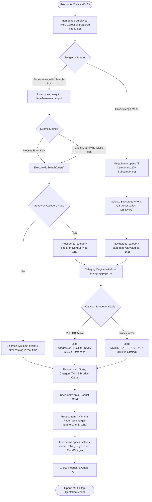
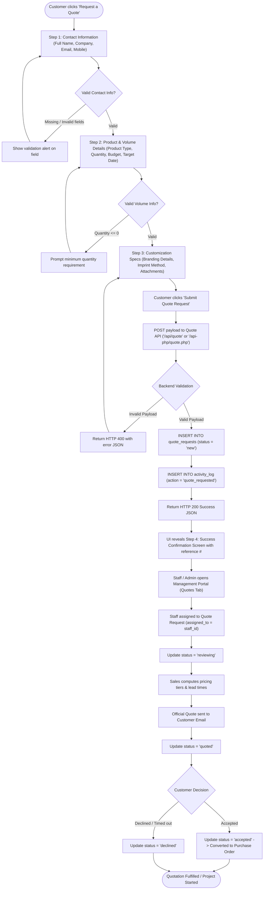
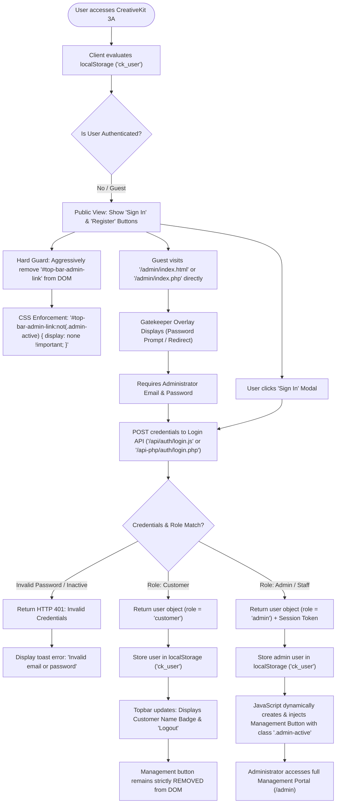

# CreativeKit 3A — Comprehensive System Flowchart & Architecture Specification

> **Project:** CreativeKit 3A Merchandising Platform  
> **Architecture:** Dual Static & Dynamic PHP/MySQL Web Application with REST APIs  
> **Subsystems:** Customer Storefront, Authentication (RBAC), Purchasing System, Inventory Management, and Management Information System (MIS)  
> **Database:** MySQL `creativekit3a_db`

---

## 1. High-Level Master Architecture Flowchart

This diagram illustrates the end-to-end operational flow of the CreativeKit 3A ecosystem across all user roles, frontend interfaces, backend processing layers, and database persistence.

```mermaid
flowchart TD
    %% User Personas
    subgraph USERS["User Actors"]
        U_GUEST["Public Visitor / Guest"]
        U_CUST["Registered Customer"]
        U_STAFF["Sales & Operations Staff"]
        U_ADMIN["Admin / Executive Management"]
    end

    %% Presentation Layer
    subgraph UI_STOREFRONT["Storefront UI Layer (HTML5 / PHP / CSS3 / Vanilla JS)"]
        UI_HOME["Homepage & Hero Carousel (index.html / index.php)"]
        UI_SEARCH["Navbar Search & Live Catalog Filter (global.js / main.js)"]
        UI_CAT["Category & Subcategory Grid (category-page.html / .php)"]
        UI_PROD["Product Variants & Details (car-charger-adapters.html / .php)"]
        UI_QUOTE["Multi-Step Quote Modal (quote-modal.js)"]
        UI_AUTH["Auth Modal (Login / Register / Password Strength)"]
    end

    subgraph UI_PORTAL["Admin & Staff Management Portal"]
        ADM_GATE["Admin Gatekeeper Modal (admin-system.js / guard.php)"]
        ADM_MIS["Information System: Executive KPIs & Reports (MIS)"]
        ADM_INV["Inventory System: Warehouse & Stock Ledger"]
        ADM_PURCH["Purchasing System: Suppliers & Purchase Orders (PO)"]
        ADM_CAT["Catalog Management: Products, Categories & Banners"]
        ADM_QUOTES["Lead Management: Quote Inquiries & Assignments"]
    end

    %% Application & Controller Layer
    subgraph BACKEND["Application & API Layer (PHP & Node.js)"]
        API_AUTH["Auth Controller (api/auth/login.js / api-php/auth/login.php)"]
        API_QUOTE["Quote Controller (api/quote.js / api-php/quote.php)"]
        API_MGMT["Management API (api/admin/system.js / api-php/admin/system.php)"]
        ACTIONS_PROD["Product Actions (actions/product-actions.php)"]
        ACTIONS_QUOTE["Quote Actions (actions/quote-actions.php)"]
        MW_GUARD["RBAC Session Guard (auth/guard.php)"]
    end

    %% Persistence Layer
    subgraph DB["Database Layer (creativekit3a_db - InnoDB)"]
        DB_USERS[("users (RBAC)")]
        DB_CAT[("categories & subcategories")]
        DB_PROD[("products & product_variants")]
        DB_QUOTES[("quote_requests")]
        DB_BANNERS[("hero_banners")]
        DB_INV[("warehouses, inventory_items, inventory_movements")]
        DB_PURCH[("suppliers, purchase_orders, purchase_order_items")]
        DB_LOGS[("activity_log & audit_logs")]
        DB_METRICS[("system_metrics_daily (MIS KPIs)")]
    end

    %% User Interactions -> Frontend
    U_GUEST -->|Browses / Searches| UI_HOME
    U_GUEST -->|Explores categories| UI_CAT
    U_GUEST -->|Views variant specs| UI_PROD
    U_GUEST -->|Submits lead inquiry| UI_QUOTE
    U_GUEST -->|Registers account| UI_AUTH

    U_CUST -->|Signs in| UI_AUTH
    U_CUST -->|Requests B2B quotation| UI_QUOTE

    U_STAFF -->|Signs in with Staff role| UI_AUTH
    U_STAFF -->|Reviews assigned quotes| ADM_QUOTES

    U_ADMIN -->|Accesses Management link| ADM_GATE
    U_ADMIN -->|Unlocks with admin credentials| UI_PORTAL

    %% Frontend -> Backend API
    UI_HOME -.->|Fetches active slides| DB_BANNERS
    UI_SEARCH -->|Search query LIKE| UI_CAT
    UI_CAT -.->|Reads category products| DB_PROD
    UI_PROD -.->|Reads variant specs| DB_PROD
    UI_QUOTE -->|POST quotation payload| API_QUOTE
    UI_AUTH -->|POST credentials| API_AUTH

    ADM_GATE -->|Verifies admin role| API_AUTH
    ADM_MIS -->|Pulls BI analytics| API_MGMT
    ADM_INV -->|Stock movements & audits| API_MGMT
    ADM_PURCH -->|Issues & receives POs| API_MGMT
    ADM_CAT -->|CRUD product items| ACTIONS_PROD
    ADM_QUOTES -->|Update status & assignment| ACTIONS_QUOTE

    %% Backend Controllers -> Database
    API_AUTH -->|Validates hash / records login| DB_USERS
    API_AUTH -->|Audit trail entry| DB_LOGS
    API_QUOTE -->|Inserts quote request| DB_QUOTES
    API_QUOTE -->|Logs lead activity| DB_LOGS

    API_MGMT -->|Queries inventory & restocks| DB_INV
    API_MGMT -->|Procurement & supplier records| DB_PURCH
    API_MGMT -->|Aggregates daily rollups| DB_METRICS
    API_MGMT -->|Records admin actions| DB_LOGS

    ACTIONS_PROD -->|Modifies products & variants| DB_PROD
    ACTIONS_PROD -->|Updates category mappings| DB_CAT
    ACTIONS_QUOTE -->|Updates quote status| DB_QUOTES
```

---

## 2. Process Flow 1: Customer Browsing, Search & Product Discovery

This flowchart depicts how visitors discover corporate giveaways, utilize the universal search engine, navigate category hierarchies, and select product variants.

---

## 3. Process Flow 2: Quotation Request & Lead Management Lifecycle

This flowchart describes the 3-step quotation process from customer form submission to staff review, quotation generation, and order closing.

---

## 4. Process Flow 3: Authentication, RBAC & Admin Gatekeeper Flow

This flowchart shows the security gating mechanism ensuring the **Management** portal remains hidden and inaccessible to unauthorized visitors while granting authorized administrators access.

---

## 5. Process Flow 4: Enterprise Purchasing, Inventory & MIS Analytics Flow

This flowchart illustrates the operational loop between stock tracking, procurement, automated restocking, and executive business intelligence.

```mermaid
flowchart TD
    %% Inventory Monitoring
    SUB_INV_START(["Continuous Inventory Monitoring"]) --> CHECK_THRESHOLD["MIS checks: quantity_on_hand <= reorder_level?"]
    
    CHECK_THRESHOLD -->|No: Stock Healthy| NORMAL_STOCK["Status = 'In Stock' -> Available in Catalog"]
    CHECK_THRESHOLD -->|Yes: Low Stock Alert| ALERT_TRIGGER["Flag: Low Stock Alert Triggered (Status = 'Low Stock')"]

    %% Purchasing Flow
    ALERT_TRIGGER --> MIS_KPI_INC["Increment low_stock_sku_count in Executive KPI Dashboard"]
    ALERT_TRIGGER --> NOTIFY_PROCUREMENT["Procurement Officer notified in Purchasing Portal"]

    NOTIFY_PROCUREMENT --> SELECT_SUPPLIER["Select approved supplier from 'suppliers' table"]
    SELECT_SUPPLIER --> DRAFT_PO["Create Purchase Order (PO-YYYY-XXXX) with status = 'draft'"]
    DRAFT_PO --> ADD_LINE_ITEMS["Specify line items, costs, and destination warehouse in 'purchase_order_items'"]
    ADD_LINE_ITEMS --> ISSUE_PO["Submit PO to Supplier -> status = 'sent'"]

    %% Supplier & Goods Receipt
    ISSUE_PO --> GOODS_ARRIVE["Supplier manufactures and delivers physical goods to Warehouse"]
    GOODS_ARRIVE --> WAREHOUSE_RECEIVE["Warehouse Inspector verifies shipment"]
    WAREHOUSE_RECEIVE --> EXEC_RECEIVE_SP["Execute Stored Procedure: CALL receive_purchase_order(po_number)"]

    %% Automated Transaction
    EXEC_RECEIVE_SP --> ATOMIC_TRANS{"ACID Transaction"}
    ATOMIC_TRANS --> STEP_A["1. UPDATE purchase_orders SET status = 'received', received_date = NOW()"]
    STEP_A --> STEP_B["2. UPDATE inventory_items: quantity_on_hand = quantity_on_hand + quantity_received"]
    STEP_B --> STEP_C["3. INSERT INTO inventory_movements (type = 'stock_in', reference = 'purchase_order')"]
    STEP_C --> STEP_D["4. INSERT INTO audit_logs (action = 'PO_RECEIVED_RESTOCKED')"]

    %% Real-time MIS Analytics Update
    STEP_D --> UPDATE_MIS["Trigger Daily KPI Aggregator (system_metrics_daily)"]
    UPDATE_MIS --> CALC_METRICS["Compute Real-Time Executive Metrics:
    - Inventory Asset Valuation (Sum of stock * unit cost)
    - Procurement Outflows Spend (Sum of received PO totals)
    - Low-stock counter decremented
    - Stock units available across Taguig & Cebu hubs"]

    CALC_METRICS --> MIS_DASHBOARD["Executive Management Portal Displays Updated Charts & CSV Reports"]
    MIS_DASHBOARD --> COMPLETED(["Operational Cycle Complete & Audited"])
```

---

## 6. Subsystem Interconnection Matrix

| Subsystem | Input Source | Primary Function | Output / Downstream Consumer |
| :--- | :--- | :--- | :--- |
| **Catalog & Navigation** | `categories`, `products`, `product_variants` | Product categorization, search filtering, variant selection | Customer Storefront, Quote Modal |
| **Quotation Engine** | Customer Input (`quote-modal.js`) | Validates 3-step lead inquiries, captures customization specs | `quote_requests`, Sales Staff Pipeline |
| **Identity & RBAC** | Storefront & Admin Modals | Password hashing (Bcrypt), session management, role verification | Management Gatekeeper, Audit Trails |
| **Purchasing System** | Procurement Officers, `suppliers` | Supplier relations, PO creation, status tracking (`draft` $\to$ `received`) | Inventory Movements, Restock Engine |
| **Inventory System** | Warehouse hubs, Purchase Orders, Orders | Multi-warehouse quantity tracking, immutable double-entry ledger | Catalog Availability, Low Stock Alerts |
| **Management Information System (MIS)** | Aggregated data from all subsystems | Real-time KPI cards, gross asset valuation, executive audit logs | Executive Management Dashboard |

---
*Document approved for CreativeKit 3A architecture documentation and academic project review.*
