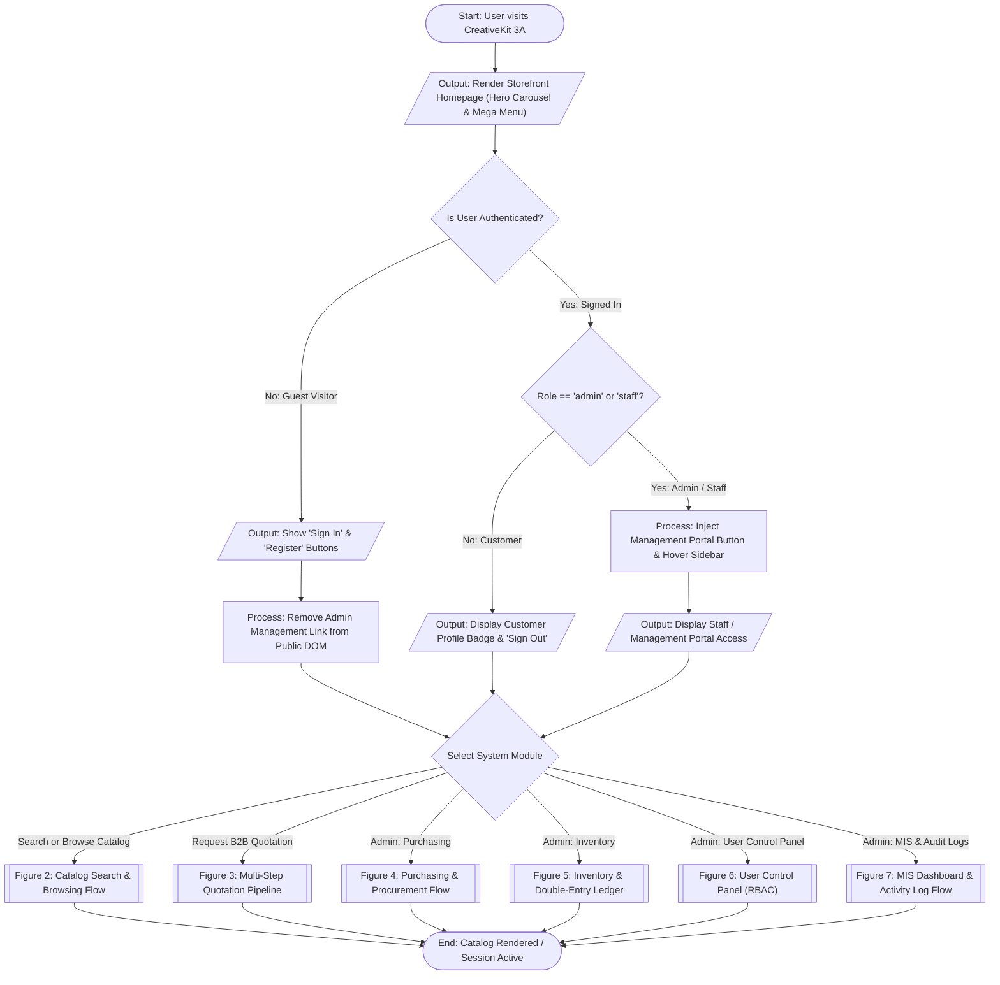
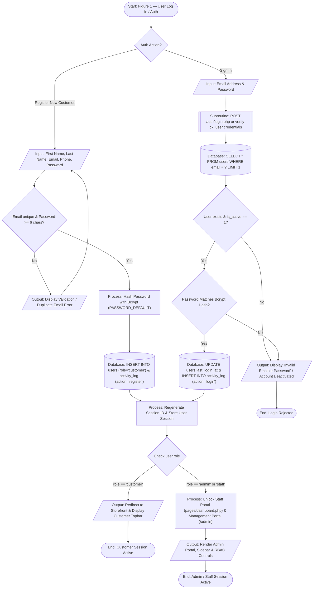
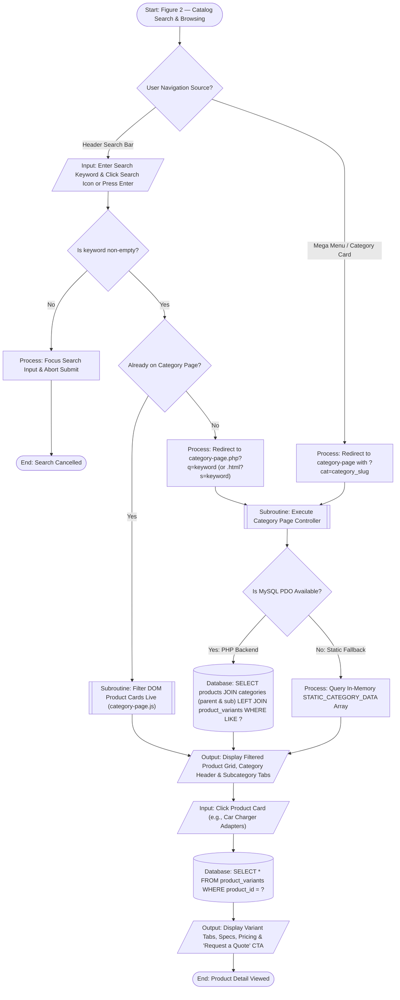
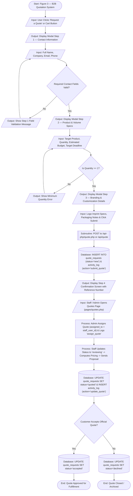
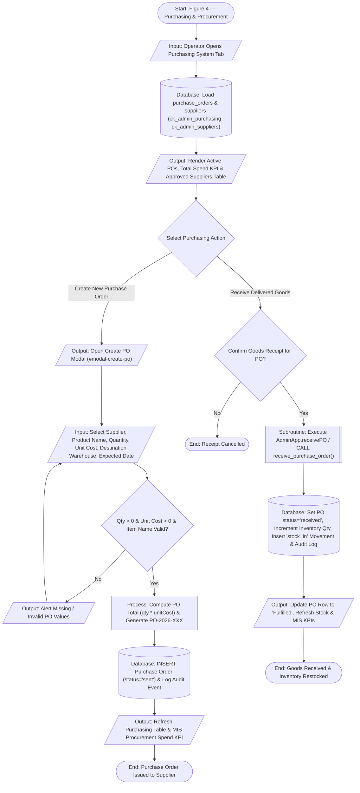
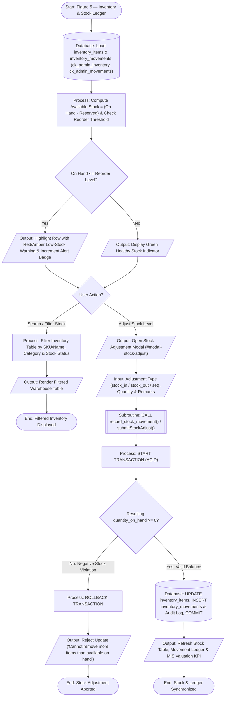
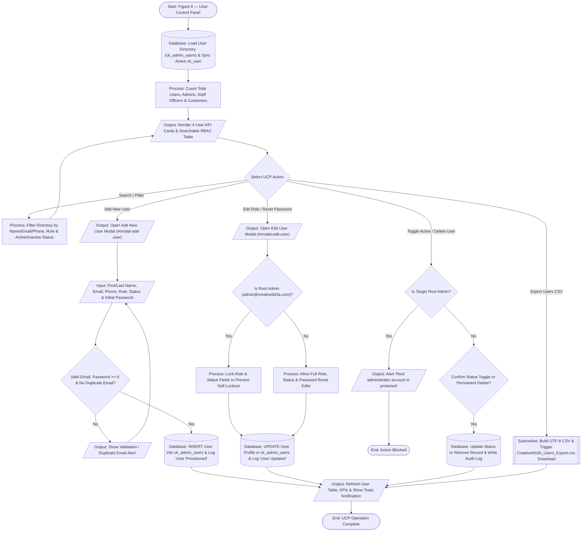
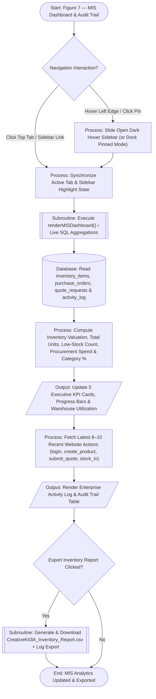

# CreativeKit 3A — Comprehensive System Flowchart & Architecture Specification

> **Project:** CreativeKit 3A Merchandising Platform  
> **Standard:** ANSI / ISO 5807 Standard Flowchart Symbols & Syntax  
> **Database:** MySQL `creativekit3a_db` (InnoDB)  
> **Subsystems:** Authentication (Login/RBAC), Catalog Search & Browsing, B2B Quotation Pipeline, Purchasing & Procurement, Inventory Movement Ledger, User Control Panel (UCP), and MIS Dashboard

---

## 1. Standard Flowchart Shape Legend (ANSI / ISO 5807)

Every diagram in this document strictly follows international standard flowcharting shapes and conventions:

| Shape Name | Mermaid Syntax | Visual Shape | Functional Purpose |
| :--- | :---: | :---: | :--- |
| **Terminator** | `(["Start / End"])` | **Oval / Stadium** | Starting point or terminal ending point of a system process. |
| **Input / Output (I/O)** | `[/"Data Input or Screen Output"/]` | **Parallelogram** | User data entry (forms, clicks, search keywords) or system output (web pages, modals, CSV exports, alerts). |
| **Process / Operation** | `["Execute Task / Calculation"]` | **Rectangle** | Internal computations, variable assignments, DOM state updates, or validations. |
| **Decision / Condition** | `{"Condition Check?"}` | **Diamond / Rhombus** | Conditional branching (`Yes` / `No`, `Valid` / `Invalid`, `Role Check`). |
| **Predefined Process / Subroutine** | `[["API Endpoint / Stored Procedure"]]` | **Double-Border Box** | External or modular routine, REST API call, PHP action handler, or MySQL stored procedure. |
| **Database Storage** | `[("Database Table / Persistence")]` | **Cylinder** | Database table query/write in `creativekit3a_db` or `localStorage` persistence. |

---

## 2. Master System Flowchart (End-to-End Platform Overview)

This high-level diagram connects all subsystems of CreativeKit 3A from initial visitor entry through storefront browsing, quoting, purchasing, inventory control, and MIS reporting.

---

## 3. Individual System Flowcharts (Figures 1–7)

### Figure 1: User Login, Registration & Role-Based Access Control (RBAC)

Illustrates credential validation, Bcrypt password verification, `activity_log` audit recording (`action = 'login'` / `'register'` / `'logout'`), and role-based portal routing across [auth/login.php](../auth/login.php), [auth/register.php](../auth/register.php), and [assets/js/admin-system.js](../assets/js/admin-system.js).

---

### Figure 2: Universal Catalog Search & Product Browsing System

Illustrates keyword search (`?q=` / `?s=`), Mega Menu category navigation (`?cat=`), MySQL 4-table `JOIN` queries, static fallback rendering for Vercel deployments, and product variant selection.

---

### Figure 3: Multi-Step B2B Quotation Pipeline & Staff Review Workflow

Illustrates the customer 3-step quotation request modal (`includes/quote-modal.php`), backend insertion into `quote_requests`, and the staff processing lifecycle (`new` → `reviewing` → `quoted` → `accepted` / `declined`).

---

### Figure 4: Enterprise Purchasing & Procurement System

Illustrates supplier management, Purchase Order (`PO-2026-XXX`) creation, goods receipt validation, and automated inventory restocking in [admin/index.html](../admin/index.html) and [assets/js/admin-system.js](../assets/js/admin-system.js).

---

### Figure 5: Inventory Management & Double-Entry Stock Movement Ledger

Illustrates warehouse stock monitoring, low-stock threshold alerts, manual stock adjustments (`Stock In`, `Stock Out`, `Adjustment`), and ACID negative-balance guardrails.

---

### Figure 6: User Control Panel (UCP) & RBAC Account Governance

Illustrates administrator user provisioning, role assignment (`admin`, `staff`, `customer`), status activation/suspension, root administrator protection, and CSV directory export.

---

### Figure 7: Management Information System (MIS) Dashboard & Audit Trail

Illustrates the executive telemetry loop, hover-activated left side navigation bar, real-time KPI aggregation, warehouse capacity snapshot, and recent website audit trail tracking.

---
*Document approved for CreativeKit 3A architecture documentation and academic project review.*
